# ETHC-VRC

ETHC-VRC 是求解带时间窗的容量约束车辆路径问题（CVRPTW）的深度强化学习方法，对应论文 *ETHC-VRC: Explicit Time-State Representation and Hybrid Constraint Handling for Time-Windowed Vehicle Routing Construction*。论文第二轮修改稿所用的代码版本标记为 `paper-r2`，训练好的模型和逐实例结果作为这一版本 Release 的附件发布（见[下载模型与结果](#下载模型与结果)）。

- **显式时间状态（ET）**：环境按论文算法1维护车辆的到达时刻 T_a（早到则等待，回到仓库后清零）。同一个时间状态既与剩余容量 C_r、车速 S_v 一起输入解码器的上下文（公式11），又决定混合成本中的迟到量（公式3）和推理时的硬掩码（公式19）。
- **混合约束处理（HC）**：训练只用软约束，迟到按 β = λ·β₀ 计罚（公式17，β₀ = 8 坐标单位/小时，默认 λ = 3，即 β = 24）。推理时同一个模型在软约束模式和硬掩码模式下各贪心解码一次（记作 G），或各采样 1,280 个解（记作 S），逐实例保留混合成本较低的解。在论文第4.3.2节的假设下，硬掩码解满足全部时间窗。

仓库包含 ETHC-VRC、两个 DRL 基线（TPA-Reward、MVMoE）和三个元启发式基线（OR-Tools、TS、BA）的实现，以及用一条命令复现论文全部表和图的编排脚本 `run_all.py`。

## 结果速览

- **与 DRL 基线比较（同一种 GPU）**：贪心解码下，ETHC-VRC(G) 在三个规模上都低于 TPA-Reward(G) 和 MVMoE(G)，相对 MVMoE(G) 分别低 0.69%、0.38%、0.03%（n=100 时 p = 0.48，不显著），解 10,000 个实例用 0.63、1.44、2.97 s。每个实例 2,560 个候选的同预算采样下，ETHC-VRC(S) 比 TPA-Reward(S) 低 17.47%–54.56%，n=20、50 时比 MVMoE(S) 低 0.84%、0.06%，只在 n=100 时高 0.54%，而 MVMoE 的参数量是 ETHC-VRC 的 5.3 倍，训练时间约为 2 倍。
- **与元启发式比较**：OR-Tools 每个实例搜索 10–120 s 时混合成本最低，ETHC-VRC(S) 比它高 2.05%、3.61%、4.33%；把 OR-Tools 的单实例时限设为 ETHC-VRC(S) 的每实例耗时（0.066 s、0.15 s、0.32 s）时，ETHC-VRC(S) 比它低 0.84%、3.95%、16.78%。
- **消融**：相对只用硬掩码解码（w/o HC），混合约束处理使混合成本降低 2.29%、2.40%、3.24%（贪心）和 0.49%、0.62%、1.27%（采样）；去掉解码器的时间状态输入（w/o ET）对测试成本的影响在训练种子间的波动之内。
- **λ 敏感性与跨规模泛化**：λ 在 1–9 之间时，ETHC-VRC 的路径长度最多变化约 1%，可行率不低于 99.99%。跨规模测试中，ETHC-VRC(G) 在全部 15 个训练—测试组合上低于 TPA-Reward(G)，在其中 8 个组合上低于 MVMoE(G)。

## 主要结果

除特别说明外，下面的结果都在每个规模 10,000 个测试实例上得到，λ = 3，模型的训练种子为 1234。贪心解码（G）时，ETHC-VRC 在两种掩码模式下各解码一次，基线解码一次。采样（S）时每个实例保留 2,560 个候选中最好的一个：ETHC-VRC 在两种模式下各采样 1,280 个，TPA-Reward 在软约束模式、MVMoE 在硬掩码模式下各采样 2,560 个。全部数字由 `analysis/report.py` 从逐实例结果计算，汇总在 `results/paper/paper_numbers.json` 中。

### 表2：与基线的比较

| 方法 | Obj. | Gap | Length | Feas. | Late (min) | Veh. | Time |
|:---|---:|---:|---:|---:|---:|---:|---:|
| **n=20** |  |  |  |  |  |  |  |
| ETHC-VRC(G) | 7.24 | 6.08% | 7.24 | 100.00% | -- | 4.49 | 0.63 s |
| ETHC-VRC(S) | 6.97 | 2.05% | 6.97 | 100.00% | -- | 4.27 | 11 min |
| TPA-Reward(G) | 10.29 | 50.66% | 10.29 | 99.98% | 23.33 | 3.95 | **0.22 s** |
| TPA-Reward(S) | 8.44 | 23.65% | 8.44 | 99.99% | 0.74 | 3.91 | 4 min |
| MVMoE(G) | 7.29 | 6.82% | 7.29 | 100.00% | -- | 4.50 | 0.59 s |
| MVMoE(S) | 7.03 | 2.92% | 7.03 | 100.00% | -- | 4.30 | 9 min |
| OR-Tools | **6.83** | **0.00%** | **6.83** | 100.00% | -- | 4.06 | 3.5 h |
| TS | 6.87 | 0.61% | 6.87 | 100.00% | -- | 4.06 | 3.5 h |
| BA | 6.83 | 0.00% | 6.83 | 100.00% | -- | 4.05 | 3.5 h |
| **n=50** |  |  |  |  |  |  |  |
| ETHC-VRC(G) | 13.07 | 8.93% | 13.07 | 100.00% | -- | 7.91 | 1.44 s |
| ETHC-VRC(S) | 12.43 | 3.61% | 12.43 | 100.00% | -- | 7.54 | 25 min |
| TPA-Reward(G) | 26.28 | 119.06% | 26.28 | 100.00% | -- | 6.85 | **0.48 s** |
| TPA-Reward(S) | 20.44 | 70.33% | 20.44 | 99.97% | 0.52 | 6.85 | 9 min |
| MVMoE(G) | 13.12 | 9.35% | 13.12 | 100.00% | -- | 7.97 | 1.25 s |
| MVMoE(S) | 12.44 | 3.67% | 12.44 | 100.00% | -- | 7.56 | 21 min |
| OR-Tools | **12.00** | **0.00%** | **12.00** | 99.99% | 0.06 | 7.08 | 19.4 h |
| TS | 12.90 | 7.49% | 12.90 | 100.00% | -- | 7.01 | 19.4 h |
| BA | 12.25 | 2.07% | 12.25 | 100.00% | -- | 7.14 | 19.4 h |
| **n=100** |  |  |  |  |  |  |  |
| ETHC-VRC(G) | 20.37 | 9.44% | 20.37 | 100.00% | -- | 11.99 | 2.97 s |
| ETHC-VRC(S) | 19.42 | 4.33% | 19.42 | 100.00% | -- | 11.60 | 53 min |
| TPA-Reward(G) | 52.69 | 183.04% | 52.69 | 100.00% | -- | 10.70 | **0.93 s** |
| TPA-Reward(S) | 42.75 | 129.63% | 42.75 | 99.92% | 1.48 | 10.69 | 17 min |
| MVMoE(G) | 20.38 | 9.47% | 20.38 | 100.00% | -- | 11.98 | 2.39 s |
| MVMoE(S) | 19.32 | 3.78% | 19.32 | 100.00% | -- | 11.52 | 45 min |
| OR-Tools | **18.62** | **0.00%** | **18.62** | 100.00% | -- | 10.97 | 19.4 h |
| TS | 21.38 | 14.86% | 21.38 | 100.00% | -- | 10.68 | 19.4 h |
| BA | 19.69 | 5.75% | 19.69 | 100.00% | -- | 11.14 | 19.4 h |

- Obj.：混合成本（公式1），ETHC-VRC 为逐实例在两种模式的解中取优后的成本；Gap：相对同规模最好的 Obj.，不是相对已证明的最优解；Length：路径长度；Feas.：没有迟到的实例比例；Late：迟到客户的平均迟到时长（分钟，`--` 表示没有迟到）；Veh.：平均车辆数；Time：整个测试集的总耗时。加粗为每个规模的最好值。
- DRL 方法都在 RTX 5090 上计时，计时评估在其他任务都完成后独占重跑一次。ETHC-VRC(G) 每批处理 1,024 个实例，时间包含两次贪心解码，摊到每个实例为 0.06、0.14、0.30 ms。采样逐个实例进行，ETHC-VRC(S) 的总时间除以 10,000 即单实例延迟 0.066 s、0.15 s、0.32 s。
- ETHC-VRC(G) 的两次解码只比 MVMoE(G) 的一次解码多用 6%、16%、24% 的时间。只用软约束模式解码一次（与基线相同的预算）时，ETHC-VRC 为 7.28、13.15、20.43，比 MVMoE(G) 低 0.16%、高 0.22%、高 0.27%；加上硬掩码的一次解码后，n=20 时领先扩大，n=50 时转为低于 MVMoE(G)，n=100 时差异不显著。
- OR-Tools、TS、BA 使用与 DRL 方法相同的罚项系数 β 和 12 辆车的车队，单实例时限为 10 s（n=20）和 120 s（n=50、100），即标定时限的 2 倍。它们在 CPU（Xeon Platinum 8470Q，8 或 18 个并行进程）上运行，时间仅供参考。

### 配对比较

ETHC-VRC 与各方法在同一批测试实例上逐实例比较。表中为逐实例成本差的均值相对后一方法平均成本的百分比（负数表示 ETHC-VRC 更低），方括号内为配对 t 分布的 95% 置信区间；双侧 Wilcoxon 符号秩检验除标注外都有 p < 0.001。

| 逐实例比较 | n=20 | n=50 | n=100 |
|:---|:---:|:---:|:---:|
| ETHC-VRC(G) − TPA-Reward(G) | −29.59% [−29.77, −29.41] | −50.27% [−50.41, −50.14] | −61.33% [−61.43, −61.24] |
| ETHC-VRC(G) − MVMoE(G) | −0.69% [−0.78, −0.59] | −0.38% [−0.45, −0.31] | −0.03% [−0.09, 0.03]，p = 0.48 |
| ETHC-VRC(G) − OR-Tools | +6.08% [6.00, 6.17] | +8.93% [8.87, 9.00] | +9.44% [9.39, 9.49] |
| ETHC-VRC(G) − TS | +5.43% [5.34, 5.53] | +1.34% [1.23, 1.46] | −4.72% [−4.84, −4.61] |
| ETHC-VRC(G) − BA | +6.08% [5.99, 6.16] | +6.73% [6.67, 6.79] | +3.49% [3.44, 3.54] |
| ETHC-VRC(S) − TPA-Reward(S) | −17.47% [−17.59, −17.35] | −39.17% [−39.26, −39.08] | −54.56% [−54.63, −54.50] |
| ETHC-VRC(S) − MVMoE(S) | −0.84% [−0.89, −0.80] | −0.06% [−0.09, −0.02] | +0.54% [0.51, 0.56] |
| ETHC-VRC(S) − OR-Tools | +2.05% [2.01, 2.09] | +3.61% [3.58, 3.64] | +4.33% [4.30, 4.36] |
| ETHC-VRC(S) − TS | +1.43% [1.37, 1.48] | −3.61% [−3.71, −3.50] | −9.17% [−9.28, −9.06] |
| ETHC-VRC(S) − BA | +2.05% [2.01, 2.09] | +1.51% [1.48, 1.55] | −1.34% [−1.37, −1.31] |
| ETHC-VRC(S) − OR-Tools（等时） | −0.84% [−0.91, −0.77] | −3.95% [−4.02, −3.88] | −16.78% [−17.50, −16.07] |

### 与 OR-Tools 的等时比较

把 OR-Tools 的单实例时限设为 ETHC-VRC(S) 的实测每实例耗时，比较相同时间下的解的质量。OR-Tools 在 CPU 上、ETHC-VRC 在 GPU 上运行，这一比较只作参考。

|  | n=20 | n=50 | n=100 |
|:---|:---:|:---:|:---:|
| 单实例时限（ETHC-VRC(S) 的实测每实例耗时） | 0.066 s | 0.15 s | 0.32 s |
| OR-Tools 的混合成本 | 7.03 | 12.94 | 23.34 |
| OR-Tools 迟到的实例比例 | 0.00% | 0.00% | 7.63% |
| ETHC-VRC(S) − OR-Tools（等时） | −0.84% | −3.95% | −16.78% |
| 对照：ETHC-VRC(S) − OR-Tools（10–120 s） | +2.05% | +3.61% | +4.33% |

### 三个训练种子

ETHC-VRC 另用种子 1235、1236 各训练了一个模型，下表为三个种子的均值 ± 种子间标准差（表2的基线只用一个种子训练）。

| 种子 1234、1235、1236 | n=20 | n=50 | n=100 |
|:---|:---:|:---:|:---:|
| ETHC-VRC(G) | 7.249 ± 0.006 | 13.077 ± 0.008 | 20.379 ± 0.040 |
| ETHC-VRC(S) | 6.973 ± 0.004 | 12.427 ± 0.007 | 19.430 ± 0.033 |

### 表3：消融

w/o ET 从解码器的上下文中去掉时间状态（T_a、S_v），环境仍维护它们，两种掩码模式都可用。w/o HC 使用完整模型的权重，只在硬掩码模式下解码（一次贪心或 2,560 个样本），而不是在两种模式下解码再逐实例取优。表中为三个训练种子的平均混合成本，加粗为每列的最低值。

| 方法 | G，n=20 | G，n=50 | G，n=100 | S，n=20 | S，n=50 | S，n=100 |
|:---|---:|---:|---:|---:|---:|---:|
| ETHC-VRC | **7.249** | **13.077** | **20.379** | **6.973** | 12.427 | **19.430** |
| w/o ET | 7.250 | 13.091 | 20.422 | 6.975 | **12.426** | 19.474 |
| w/o HC | 7.419 | 13.398 | 21.062 | 7.007 | 12.505 | 19.680 |

下表为逐实例成本差的均值相对参照方法平均成本的百分比（三个种子取平均）；w/o ET 两行另给按测试实例的 95% 置信区间和种子间标准差（百分点）。

|  | n=20 | n=50 | n=100 |
|:---|:---:|:---:|:---:|
| w/o ET − ETHC-VRC（G） | +0.02% [−0.03, 0.06]，标准差 0.07 | +0.11% [0.07, 0.15]，标准差 0.22 | +0.21% [0.18, 0.24]，标准差 0.35 |
| w/o ET − ETHC-VRC（S） | +0.03% [0.01, 0.06]，标准差 0.12 | −0.01% [−0.03, 0.01]，标准差 0.08 | +0.23% [0.21, 0.25]，标准差 0.42 |
| ETHC-VRC − w/o HC（G） | −2.29% | −2.40% | −3.24% |
| ETHC-VRC − w/o HC（S） | −0.49% | −0.62% | −1.27% |

去掉时间状态输入使测试成本的变化不超过 0.23%，小于种子间的标准差；混合约束处理相对 w/o HC 降低 2.29%、2.40%、3.24%（贪心，两次解码对一次）和 0.49%、0.62%、1.27%（采样，候选数相同）。

<details>
<summary>各训练种子的结果</summary>

| 方法 | 解码 | 训练种子 | n=20 | n=50 | n=100 |
|:---|:---:|:---:|---:|---:|---:|
| ETHC-VRC | G | 1234 | 7.244 | 13.069 | 20.374 |
| ETHC-VRC | G | 1235 | 7.247 | 13.076 | 20.341 |
| ETHC-VRC | G | 1236 | 7.255 | 13.085 | 20.421 |
| ETHC-VRC | S | 1234 | 6.969 | 12.431 | 19.424 |
| ETHC-VRC | S | 1235 | 6.975 | 12.432 | 19.400 |
| ETHC-VRC | S | 1236 | 6.975 | 12.420 | 19.465 |
| w/o ET | G | 1234 | 7.250 | 13.115 | 20.385 |
| w/o ET | G | 1235 | 7.245 | 13.066 | 20.464 |
| w/o ET | G | 1236 | 7.253 | 13.091 | 20.415 |
| w/o ET | S | 1234 | 6.980 | 12.438 | 19.449 |
| w/o ET | S | 1235 | 6.974 | 12.420 | 19.533 |
| w/o ET | S | 1236 | 6.971 | 12.421 | 19.441 |
| w/o HC | G | 1234 | 7.399 | 13.366 | 21.205 |
| w/o HC | G | 1235 | 7.418 | 13.444 | 20.901 |
| w/o HC | G | 1236 | 7.438 | 13.384 | 21.079 |
| w/o HC | S | 1234 | 6.997 | 12.489 | 19.767 |
| w/o HC | S | 1235 | 7.007 | 12.535 | 19.597 |
| w/o HC | S | 1236 | 7.017 | 12.489 | 19.675 |

</details>

### 图3：惩罚缩放因子 λ 的敏感性

| (a) 训练规模 n=20 | (b) 训练规模 n=50 | (c) 训练规模 n=100 |
|:---:|:---:|:---:|
| 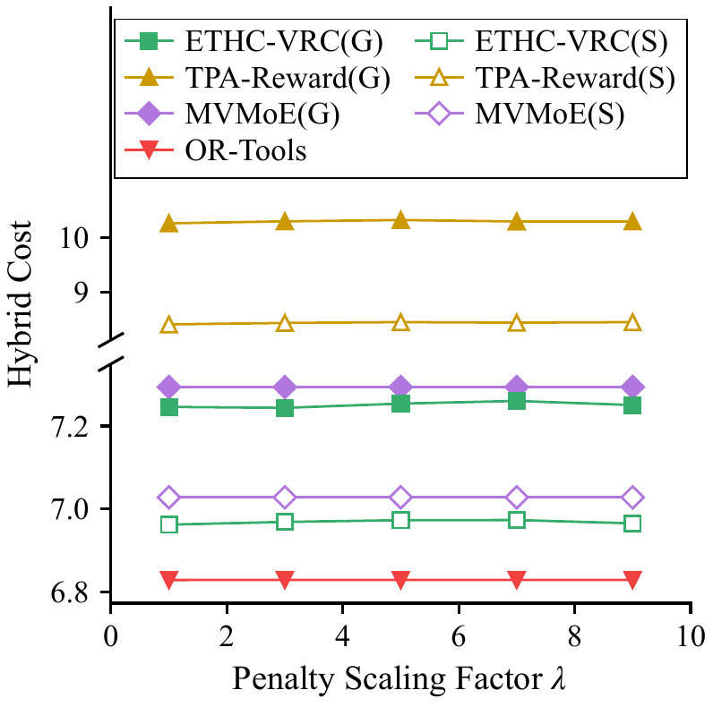 | 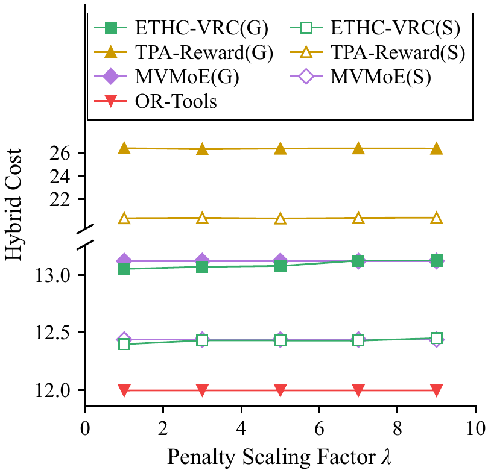 | 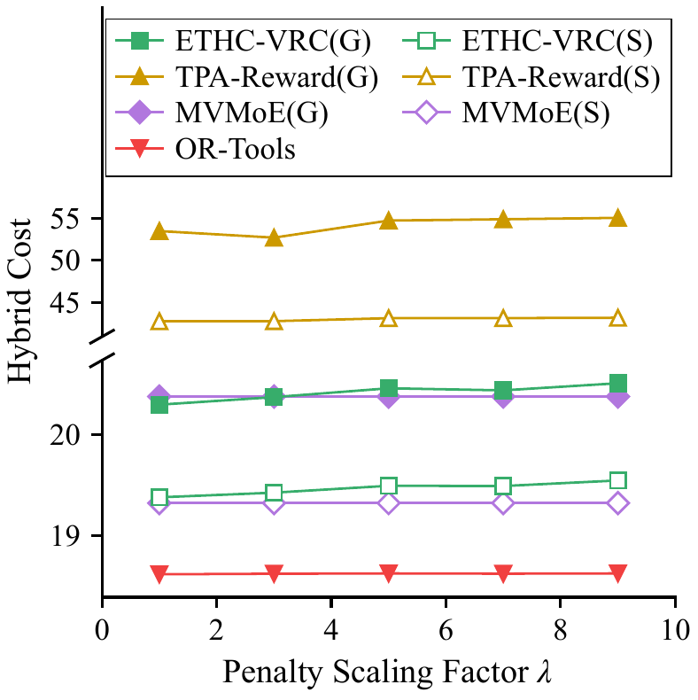 |

ETHC-VRC、TPA-Reward、MVMoE 在贪心解码（G）和采样（S）下以及 OR-Tools 在 λ ∈ {1, 3, 5, 7, 9} 时的混合成本。ETHC-VRC 和 TPA-Reward 每个 λ 单独训练一个模型；MVMoE 训练和解码都用硬掩码，从不迟到，混合成本与 λ 无关，各 λ 处画同一个模型的值。纵轴断开，TPA-Reward(G)、TPA-Reward(S) 画在断轴以上。

- 各方法在每个 λ 下迟到的实例都不超过 0.29%，混合成本与路径长度相差不到 0.03%。ETHC-VRC 只在 λ = 1 时迟到：n=50 时贪心解码有 1 个实例迟到，n=100 时贪心解码和采样各有 1 个。
- λ 从 1 到 9，ETHC-VRC(G) 的路径长度最多变化 0.23%、0.55%、1.05%，ETHC-VRC(S) 最多变化 0.16%、0.42%、0.87%；OR-Tools 每个实例搜索 10–120 s，几乎不受 λ 影响（不超过 0.05%）；TPA-Reward(G) 和 TPA-Reward(S) 最多变化 0.60%、0.35%、4.47% 和 0.48%、0.31%、0.96%。
- 各 λ 下 ETHC-VRC(G)、ETHC-VRC(S) 都远低于 TPA-Reward(G)、TPA-Reward(S)，ETHC-VRC(S) 比 OR-Tools 高 2.0%–5.0%。与 MVMoE 相比，n=20 时 ETHC-VRC 在各 λ 下都更低（贪心低 0.46%–0.69%，采样低 0.78%–0.94%）；n=50 时贪心在 λ ≤ 5、采样在 λ ≤ 7 时更低，其余最多高 0.10%；n=100 时 ETHC-VRC(G) 在 λ ≤ 3 时更低，λ ≥ 5 时最多高 0.65%，ETHC-VRC(S) 比参数量大得多的 MVMoE(S) 高 0.30%–1.16%。

<details>
<summary>图3的数据：各 λ 下的混合成本与路径长度的变化</summary>

**n=20**

| 方法 | λ = 1 | λ = 3 | λ = 5 | λ = 7 | λ = 9 | 路径长度的变化 |
|:---|---:|---:|---:|---:|---:|---:|
| ETHC-VRC(G) | 7.246 | 7.244 | 7.254 | 7.260 | 7.251 | 0.23% |
| ETHC-VRC(S) | 6.962 | 6.969 | 6.973 | 6.973 | 6.965 | 0.16% |
| TPA-Reward(G) | 10.253 | 10.288 | 10.312 | 10.286 | 10.287 | 0.60% |
| TPA-Reward(S) | 8.418 | 8.443 | 8.458 | 8.449 | 8.458 | 0.48% |
| OR-Tools | 6.828 | 6.828 | 6.828 | 6.828 | 6.828 | 0.00% |

MVMoE(G)、MVMoE(S)：7.294、7.028（各 λ 相同）。

**n=50**

| 方法 | λ = 1 | λ = 3 | λ = 5 | λ = 7 | λ = 9 | 路径长度的变化 |
|:---|---:|---:|---:|---:|---:|---:|
| ETHC-VRC(G) | 13.051 | 13.069 | 13.077 | 13.123 | 13.123 | 0.55% |
| ETHC-VRC(S) | 12.398 | 12.431 | 12.430 | 12.429 | 12.450 | 0.42% |
| TPA-Reward(G) | 26.374 | 26.282 | 26.340 | 26.361 | 26.345 | 0.35% |
| TPA-Reward(S) | 20.404 | 20.435 | 20.378 | 20.430 | 20.441 | 0.31% |
| OR-Tools | 11.996 | 11.997 | 11.997 | 11.997 | 11.997 | 0.01% |

MVMoE(G)、MVMoE(S)：13.119、12.438（各 λ 相同）。

**n=100**

| 方法 | λ = 1 | λ = 3 | λ = 5 | λ = 7 | λ = 9 | 路径长度的变化 |
|:---|---:|---:|---:|---:|---:|---:|
| ETHC-VRC(G) | 20.299 | 20.374 | 20.462 | 20.442 | 20.513 | 1.05% |
| ETHC-VRC(S) | 19.378 | 19.424 | 19.493 | 19.490 | 19.545 | 0.87% |
| TPA-Reward(G) | 53.478 | 52.694 | 54.727 | 54.882 | 55.049 | 4.47% |
| TPA-Reward(S) | 42.748 | 42.751 | 43.105 | 43.115 | 43.156 | 0.96% |
| OR-Tools | 18.612 | 18.617 | 18.621 | 18.618 | 18.621 | 0.05% |

MVMoE(G)、MVMoE(S)：20.380、19.321（各 λ 相同）。

「路径长度的变化」为 λ 从 1 到 9 时路径长度的最大值与最小值之差相对最小值的百分比。

</details>

### 图4：跨规模泛化

| (a) 训练规模 n=20 | (b) 训练规模 n=50 | (c) 训练规模 n=100 |
|:---:|:---:|:---:|
| 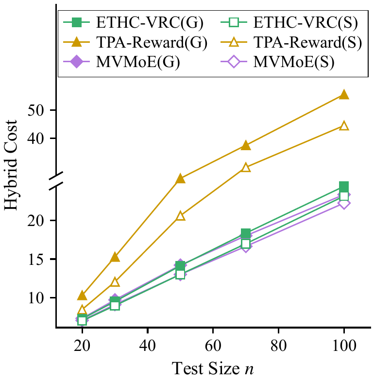 | 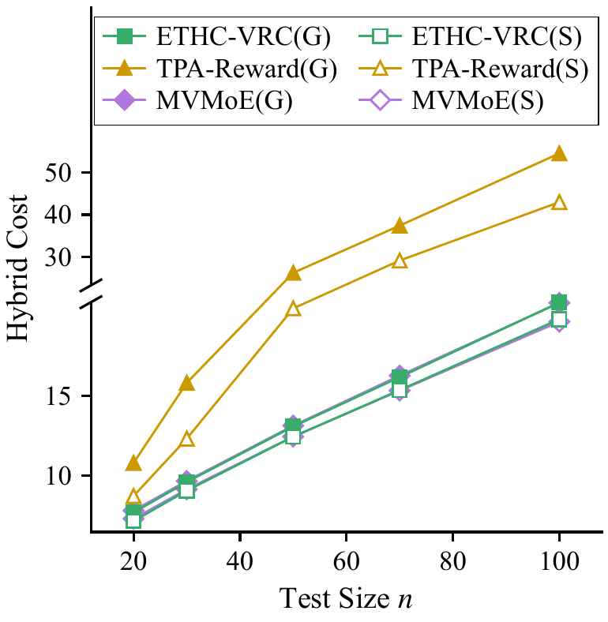 | 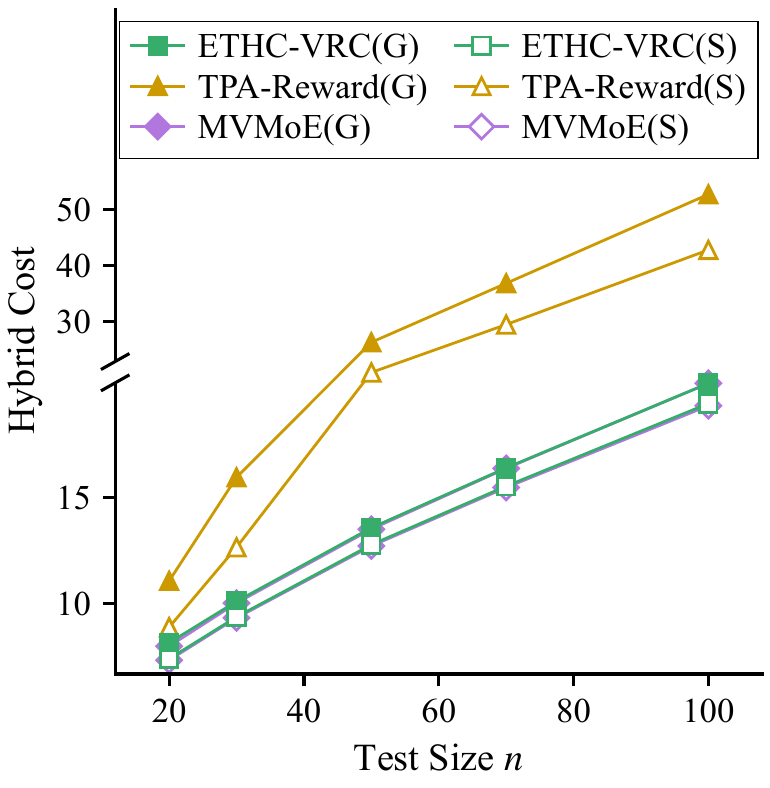 |

用 20、50、100 个节点训练的模型在 20、30、50、70、100 个节点的测试集上的混合成本（每个测试规模 10,000 个实例，生成器相同）。断轴以上压缩了纵轴的比例，以便画下 TPA-Reward(G)、TPA-Reward(S)，没有省略任何数值区间。

- 贪心解码下，ETHC-VRC 在全部 15 个训练—测试组合上低于 TPA-Reward：TPA-Reward(G) 的混合成本是 ETHC-VRC(G) 的 1.4–2.6 倍；采样下，TPA-Reward(S) 是 ETHC-VRC(S) 的 1.2–2.2 倍。
- ETHC-VRC(G) 在 8 个组合上低于 MVMoE(G)，包括测试规模等于训练规模的三个（n=100 时差异不显著）：用 20、50 个节点训练的模型在不超过 50、70 个节点的测试集上更低，最多低 2.14%、1.58%。在其余 7 个组合上，ETHC-VRC(G) 高于参数量为其 5.3 倍的 MVMoE(G)，其中 4 个相差不到 1%，规模变化最大的 20→70、20→100、100→20 高 1.9%–4.6%。
- 相同的采样预算下，ETHC-VRC(S) 在全部组合上低于 TPA-Reward(S)，在 5 个组合上低于 MVMoE(S)（20→20、20→30、50→20、50→30、50→50），其余 10 个组合中有 8 个相差不到 1%。
- 采样在全部 15 个组合上都降低了 ETHC-VRC 的混合成本。例如用 20 个节点训练的模型测试 100 个节点时，ETHC-VRC 从 24.46 降到 23.18（5.2%），MVMoE 从 23.38 降到 22.27（4.7%）。

<details>
<summary>图4的数据：各训练—测试组合的混合成本与相对 MVMoE 的差</summary>

**训练规模 n=20**

| 方法 | 测试 20 | 测试 30 | 测试 50 | 测试 70 | 测试 100 |
|:---|---:|---:|---:|---:|---:|
| ETHC-VRC(G) | 7.244 | 9.488 | 14.133 | 18.365 | 24.455 |
| ETHC-VRC(S) | 6.969 | 8.947 | 13.010 | 16.992 | 23.184 |
| TPA-Reward(G) | 10.288 | 15.278 | 26.041 | 37.633 | 55.399 |
| TPA-Reward(S) | 8.443 | 12.044 | 20.639 | 29.928 | 44.518 |
| MVMoE(G) | 7.294 | 9.695 | 14.210 | 18.029 | 23.379 |
| MVMoE(S) | 7.028 | 9.082 | 13.000 | 16.650 | 22.274 |
| ETHC-VRC(G) − MVMoE(G) | −0.69% | −2.14% | −0.54% | +1.87% | +4.60% |
| ETHC-VRC(S) − MVMoE(S) | −0.84% | −1.48% | +0.07% | +2.06% | +4.08% |

**训练规模 n=50**

| 方法 | 测试 20 | 测试 30 | 测试 50 | 测试 70 | 测试 100 |
|:---|---:|---:|---:|---:|---:|
| ETHC-VRC(G) | 7.701 | 9.604 | 13.069 | 16.147 | 20.800 |
| ETHC-VRC(S) | 7.168 | 9.065 | 12.431 | 15.338 | 19.758 |
| TPA-Reward(G) | 10.795 | 15.787 | 26.282 | 37.416 | 54.446 |
| TPA-Reward(S) | 8.730 | 12.309 | 20.435 | 29.187 | 42.958 |
| MVMoE(G) | 7.825 | 9.670 | 13.119 | 16.242 | 20.777 |
| MVMoE(S) | 7.306 | 9.153 | 12.438 | 15.309 | 19.604 |
| ETHC-VRC(G) − MVMoE(G) | −1.58% | −0.69% | −0.38% | −0.59% | +0.11% |
| ETHC-VRC(S) − MVMoE(S) | −1.89% | −0.95% | −0.06% | +0.19% | +0.79% |

**训练规模 n=100**

| 方法 | 测试 20 | 测试 30 | 测试 50 | 测试 70 | 测试 100 |
|:---|---:|---:|---:|---:|---:|
| ETHC-VRC(G) | 8.141 | 10.093 | 13.564 | 16.389 | 20.374 |
| ETHC-VRC(S) | 7.388 | 9.363 | 12.767 | 15.526 | 19.424 |
| TPA-Reward(G) | 11.060 | 15.940 | 26.247 | 36.785 | 52.694 |
| TPA-Reward(S) | 8.877 | 12.647 | 20.889 | 29.417 | 42.751 |
| MVMoE(G) | 7.981 | 10.017 | 13.500 | 16.368 | 20.380 |
| MVMoE(S) | 7.324 | 9.315 | 12.708 | 15.465 | 19.321 |
| ETHC-VRC(G) − MVMoE(G) | +2.01% | +0.76% | +0.47% | +0.13% | −0.03%（不显著） |
| ETHC-VRC(S) − MVMoE(S) | +0.88% | +0.52% | +0.46% | +0.40% | +0.54% |

「ETHC-VRC(G) − MVMoE(G)」和「ETHC-VRC(S) − MVMoE(S)」为逐实例成本差的均值相对 MVMoE 平均成本的百分比；除标注「不显著」的一格外，双侧 Wilcoxon 符号秩检验都有 p < 0.05。

</details>

### 图5：训练曲线

| (a) n=20 | (b) n=50 | (c) n=100 |
|:---:|:---:|:---:|
| 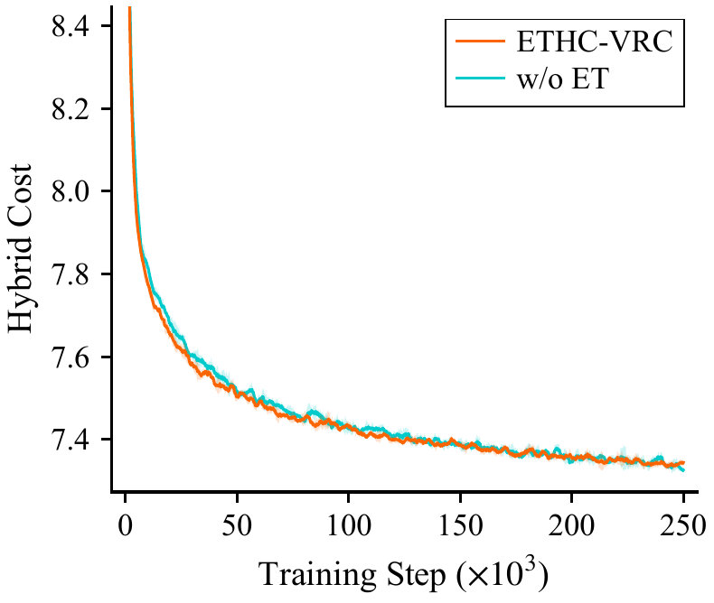 | 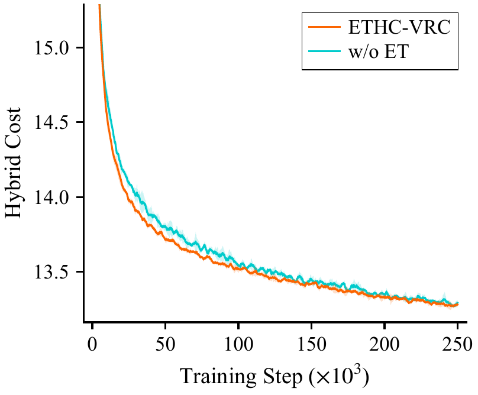 | 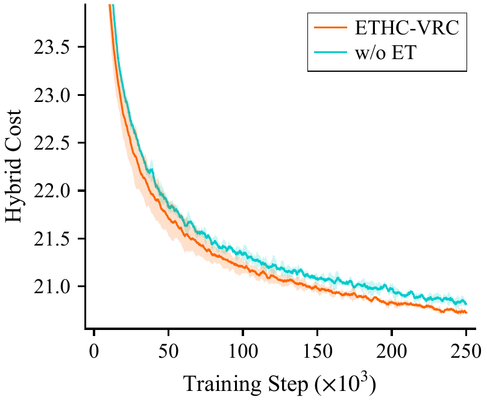 |

完整模型（ETHC-VRC）与 w/o ET 在训练批次上的混合成本：三个种子的均值，阴影为种子间 ±1 个标准差。曲线为一个 epoch（2,500 步）的滑动平均，纵轴上限为最终成本的 1.15 倍，训练最初成本极高的一段在图的上方之外。w/o HC 与完整模型只在推理时不同，没有训练曲线。

| 最后一个 epoch 的训练成本 | n=20 | n=50 | n=100 |
|:---|:---:|:---:|:---:|
| ETHC-VRC | 7.343 ± 0.007 | 13.279 ± 0.010 | 20.742 ± 0.013 |
| w/o ET | 7.330 ± 0.007 | 13.283 ± 0.018 | 20.839 ± 0.038 |

n=20、50 时两者收敛到几乎相同的训练成本；n=100 时完整模型的三个种子都低于 w/o ET 的三个种子（平均 20.74 对 20.84）。每个模型目录下的 `train_log.csv` 每 50 步记录一次训练批次的平均成本，`val_log.csv` 每个 epoch 记录一次验证集成本、基线检验结果和这个 epoch 的用时。

### 图6：采样解的分布

| (a) n=20 | (b) n=50 | (c) n=100 |
|:---:|:---:|:---:|
| 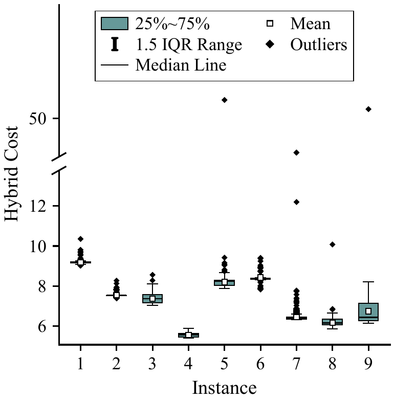 | 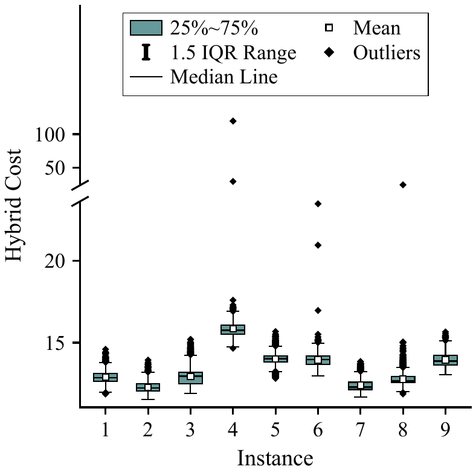 | 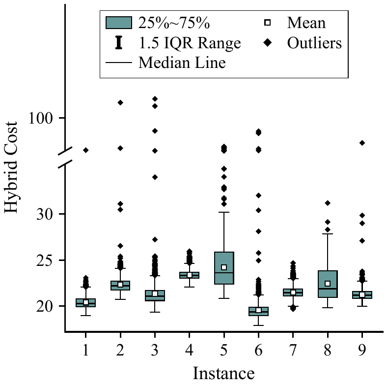 |

ETHC-VRC(S) 为每个规模的前 9 个测试实例采样的 2,560 个解（两种掩码模式各 1,280 个）的混合成本分布：箱体为 25%–75% 分位，须为 1.5 倍四分位距，方块为均值。纵轴在最大实例中位数的 1.5 倍处断开，断轴以上画少数罚项极大的解（n=20、50、100 时分别为 23,040 个解中的 4、3、20 个）。

<details>
<summary>图6的数据：各实例采样解的分位数</summary>

**n=20**（断轴位置 13.78）

| 实例 | 中位数 | 均值 | 最小值 | 25% | 75% | 最大值 | 断轴以上的解 |
|:---:|---:|---:|---:|---:|---:|---:|---:|
| 1 | 9.19 | 9.18 | 9.02 | 9.15 | 9.21 | 10.35 | 0 |
| 2 | 7.53 | 7.55 | 7.40 | 7.53 | 7.53 | 8.26 | 0 |
| 3 | 7.36 | 7.36 | 7.03 | 7.15 | 7.57 | 8.56 | 0 |
| 4 | 5.55 | 5.54 | 5.39 | 5.45 | 5.63 | 5.87 | 0 |
| 5 | 8.23 | 8.20 | 7.86 | 8.03 | 8.30 | 66.30 | 1 |
| 6 | 8.35 | 8.42 | 7.83 | 8.35 | 8.38 | 9.40 | 0 |
| 7 | 6.41 | 6.44 | 6.31 | 6.33 | 6.43 | 19.38 | 2 |
| 8 | 6.14 | 6.16 | 5.84 | 6.07 | 6.34 | 10.08 | 0 |
| 9 | 6.42 | 6.73 | 6.14 | 6.25 | 7.14 | 58.11 | 1 |

**n=50**（断轴位置 23.65）

| 实例 | 中位数 | 均值 | 最小值 | 25% | 75% | 最大值 | 断轴以上的解 |
|:---:|---:|---:|---:|---:|---:|---:|---:|
| 1 | 12.85 | 12.89 | 11.87 | 12.64 | 13.10 | 14.59 | 0 |
| 2 | 12.22 | 12.27 | 11.52 | 12.03 | 12.49 | 13.93 | 0 |
| 3 | 12.94 | 12.92 | 11.90 | 12.49 | 13.18 | 15.20 | 0 |
| 4 | 15.77 | 15.86 | 14.66 | 15.52 | 16.08 | 119.60 | 2 |
| 5 | 14.01 | 14.00 | 12.81 | 13.81 | 14.20 | 15.68 | 0 |
| 6 | 13.96 | 13.95 | 12.96 | 13.66 | 14.18 | 23.50 | 0 |
| 7 | 12.27 | 12.39 | 11.67 | 12.13 | 12.57 | 13.84 | 0 |
| 8 | 12.66 | 12.76 | 11.86 | 12.55 | 12.92 | 24.21 | 1 |
| 9 | 13.88 | 13.94 | 13.02 | 13.61 | 14.22 | 15.66 | 0 |

**n=100**（断轴位置 35.42）

| 实例 | 中位数 | 均值 | 最小值 | 25% | 75% | 最大值 | 断轴以上的解 |
|:---:|---:|---:|---:|---:|---:|---:|---:|
| 1 | 20.28 | 20.39 | 18.94 | 19.92 | 20.77 | 37.00 | 1 |
| 2 | 22.21 | 22.33 | 20.74 | 21.76 | 22.70 | 130.23 | 2 |
| 3 | 21.06 | 21.34 | 19.32 | 20.59 | 21.69 | 137.56 | 4 |
| 4 | 23.32 | 23.37 | 22.08 | 23.01 | 23.66 | 25.96 | 0 |
| 5 | 23.62 | 24.21 | 20.85 | 22.39 | 25.86 | 44.15 | 7 |
| 6 | 19.38 | 19.54 | 17.90 | 18.97 | 19.87 | 74.10 | 5 |
| 7 | 21.45 | 21.49 | 19.67 | 21.08 | 21.84 | 24.68 | 0 |
| 8 | 21.88 | 22.44 | 19.82 | 20.93 | 23.82 | 31.19 | 0 |
| 9 | 21.17 | 21.24 | 19.98 | 20.83 | 21.58 | 51.14 | 1 |

</details>

### 模型规模与计算开销

| | ETHC-VRC | MVMoE | TPA-Reward |
|:---|:---:|:---:|:---:|
| 参数量 | 693,120 | 3,698,944 | 658,304 |
| 训练时间，n=50 | 11.9 h | 23.7 h | -- |
| 训练时间，n=100 | 22.3 h | 45.2 h | -- |
| 贪心解码 10,000 个实例，n=100 | 2.97 s（两次解码） | 2.39 s | 0.93 s |
| 采样的单实例延迟，n=100 | 0.32 s | 0.27 s | 0.10 s |

- 三种模型使用同一训练流程和预算：REINFORCE + rollout 基线，100 个 epoch，每个 epoch 2,500 步、每批 512 个实例，Adam，学习率 10⁻⁴。w/o ET 的参数量为 692,864。
- 训练时间是单独占用一张 RTX 5090 的墙钟时间（中途续跑的为各次运行之和）。n=20 的模型和 TPA-Reward 与其他任务共用显卡，训练时间不可比，没有列出。
- 参数量从检查点统计：`uv run python -c "from utils import load_model; m, _ = load_model('outputs/paper/mvmoe_n100_l3_s1234'); print(sum(p.numel() for p in m.parameters()))"`。

### 实验环境

- 训练、评估与表2的计时都在 AutoDL 上配有 RTX 5090（32 GB）和 Xeon Platinum 8470Q 的主机上进行（下面第三条的 21 个补充评估除外）；软件为 Ubuntu 22.04、Python 3.11、PyTorch 2.11（CUDA 12.8）、NumPy 2.4、OR-Tools 9.15。`results/paper/environment.json` 记录了每次运行的硬件与软件版本。
- 元启发式在同一型号的 CPU 上运行，n=20 用 8 个并行进程，n=50、100 用 18 个。
- 图3、图4 中 TPA-Reward(S)、MVMoE(S) 的 36 个评估（λ ≠ 3 时的 TPA-Reward(S)，以及测试规模不等于训练规模时的 TPA-Reward(S)、MVMoE(S)）在正式运行之后用同一代码和设置补跑：15 个在 RTX 5090 上，21 个在 RTX 4060 Ti 上。它们只用于这两张图的成本，不涉及计时；每个评估结果的 JSON 文件在 `device` 字段记录了所用的显卡。

## 复现

### 环境

```bash
uv sync                      # Python 3.11 + PyTorch 2.11（CUDA 12.8），版本锁定在 uv.lock
uv run pytest -q             # 单元测试：时间状态、掩码、成本函数、实验清单、各模型与元启发式
```

仓库若放在云同步目录中，可把虚拟环境和模型检查点放到同步目录之外：

```bash
export UV_PROJECT_ENVIRONMENT=~/.venvs/ethc-vrc   # 虚拟环境
export ETHC_OUTPUTS=~/ethc-vrc-runs                # 模型检查点（结果文件仍写在 results/）
```

### 下载模型与结果

`paper-r2` 的 Release（<https://github.com/yeqing9349/ETHC-VRC/releases/tag/paper-r2>）附有两个压缩包，在仓库根目录下载并解压：

```bash
curl -LO https://github.com/yeqing9349/ETHC-VRC/releases/download/paper-r2/ethc-vrc-paper-r2-models.tar.gz
curl -LO https://github.com/yeqing9349/ETHC-VRC/releases/download/paper-r2/ethc-vrc-paper-r2-results.tar.gz
tar -xzf ethc-vrc-paper-r2-models.tar.gz      # 解压到 outputs/paper/
tar -xzf ethc-vrc-paper-r2-results.tar.gz     # 解压到 results/paper/
```

| 压缩包 | 内容 |
|:---|:---|
| `ethc-vrc-paper-r2-models.tar.gz` | `outputs/paper/` 下的 48 个模型目录：ETHC-VRC 21 个（3 个规模 × 5 个 λ，λ = 3 另有种子 1235、1236）、w/o ET 9 个（3 个规模 × 3 个种子）、TPA-Reward 15 个（3 个规模 × 5 个 λ）、MVMoE 3 个。每个目录有 `args.json`（训练参数）、`epoch-99.pt`（最后一个 epoch 的权重，论文所用）、`train_log.csv`、`val_log.csv` 和 `done.json` |
| `ethc-vrc-paper-r2-results.tar.gz` | `results/paper/`：每个评估与求解的结果（`eval/`、`solvers/`；`.npz` 为逐实例的成本、路径长度、迟到、车辆数和解的访问序列，`.json` 为汇总指标与计时）、各任务的日志（`logs/`）、表2与表3（`table2.*`、`table3.*`）、图3–6（`figures/*.pdf`）、`paper_numbers.json`、`environment.json` 和 `data_check.json` |

模型目录名为 `<方法>_n<训练规模>_l<λ>_s<种子>`，方法为 `ethc`、`ethc_woet`（w/o ET）、`tpa`、`mvmoe`。测试集与验证集已在仓库中（`data/cvrptw/`，由 `generate_data.py` 以 NumPy 种子 1234、4321 生成）；`run_all.py` 的 `data` 阶段会重新生成并核对它们与仓库中的文件相同。

### 从发布的结果重新生成表和图（不需要 GPU）

```bash
uv run python -m analysis.report --config configs/autodl.yaml
```

这条命令读取 `results/paper/` 中的逐实例结果，重新写出表2、表3（`table2.csv/.tex`、`table3.csv/.tex`）、图3–6（`results/paper/figures/*.pdf`）和 `paper_numbers.json`。`configs/autodl.yaml` 是论文正式运行所用的配置，实验设置与 `configs/paper.yaml` 相同，只有元启发式时限（读取在服务器 CPU 上的标定结果）、并行进程数和硬件检查三处按服务器调整。只重画图，并核对画图所用的数字与已有的 `paper_numbers.json` 相同：

```bash
uv run python -m analysis.report --config configs/autodl.yaml --figures-only --fig-dir results/paper/figures_check
```

README 中的图片 `docs/figures/*.png` 由论文图3–6 的 PDF 按 250 dpi 转换得到。

### 用发布的模型重新评估

```bash
# ETHC-VRC(G)：n=100 的模型在两种掩码模式下各贪心解码一次，逐实例取优
uv run python eval.py --model outputs/paper/ethc_n100_l3_s1234 --dataset data/cvrptw/cvrptw100_test_seed1234.pkl \
    --out results/check/ethc_n100_greedy --strategy greedy --modes soft hard
# ETHC-VRC(S)：每种模式每个实例采样 1,280 个解（RTX 5090 上约 53 分钟）
uv run python eval.py --model outputs/paper/ethc_n100_l3_s1234 --dataset data/cvrptw/cvrptw100_test_seed1234.pkl \
    --out results/check/ethc_n100_sample --strategy sample --modes soft hard --samples 1280
# w/o HC：同一模型只在硬掩码模式下采样 2,560 个解；MVMoE 用 --modes hard，TPA-Reward 用 --modes soft
uv run python eval.py --model outputs/paper/ethc_n100_l3_s1234 --dataset data/cvrptw/cvrptw100_test_seed1234.pkl \
    --out results/check/ethc_n100_hard_2560 --strategy sample --modes hard --samples 2560
```

每次评估输出 `<out>.json`（汇总指标、各模式的指标、各模式的解被选中的比例与计时）和 `<out>.npz`（逐实例结果）。在 RTX 5090 上，表2的 18 个计时重跑与原评估的逐实例成本完全相同；换用其他显卡时，结果可能因浮点运算的差异而有细微不同。

### 从头复现

```bash
# 1) 冒烟测试：极小设置跑通全部阶段，测各模型的计时并标定元启发式时限，然后估算正式运行的 GPU·h 与 CPU·h
uv run python run_all.py --config configs/smoke.yaml
uv run python estimate.py                      # 输出 results/smoke/estimate.md

# 2) 正式运行（表2、表3、图3–6、正文统计）
uv run python run_all.py --config configs/paper.yaml            # 单卡
uv run python run_all.py --config configs/paper.yaml --gpus 0,1,2,3
```

- 结果：`results/paper/` 下的表2、表3（`table2.csv/.tex`、`table3.csv/.tex`）、图3–6（`figures/*.pdf`），以及 `paper_numbers.json`（表2、表3 和图3–6 用到的全部数字、配对检验与各模式的分项指标，并记录每个数字的来源文件）。
- 全部 282 个任务：48 个训练、189 个评估、21 个元启发式求解、18 个计时评估、3 个等时比较，以及数据检查、时限标定和汇总各 1 个。
- 已完成的任务自动跳过；训练和元启发式求解中断后重新运行会从断点继续。同一配置同时只能有一个 `run_all.py` 在运行（锁文件 `results/<配置名>/run_all.lock`）。
- `--dry-run` 列出任务及状态；`--only train,eval` 只运行指定阶段；`--tasks-per-gpu` 指定每张卡同时运行的 GPU 任务数，可按规模给出（如 `20:3,50:3,100:2`）；`--emit-slurm slurm/` 为算力中心生成 Slurm 作业脚本（每个阶段一个作业数组，按依赖提交）。
- 全部设置集中在 `configs/paper.yaml`：规模、λ 列表 {1, 3, 5, 7, 9}、消融种子 {1234, 1235, 1236}、训练与评估参数、元启发式参数。
- 阶段：`data`（数据检查）→ `train` → `eval` → `solve`（OR-Tools、TS、BA，时限读取 `results/calibration/time_limits.json`）→ `timing`（表2的计时：同规模的评估在其他任务都完成后独占重跑一次，任务名带 `_timing`）→ `equal_time`（OR-Tools 以 ETHC-VRC(S) 的实测每实例耗时为时限的等时比较）→ `analysis`。
- 派发顺序在 `schedule` 段：表2（按规模从小到大）→ 多种子消融、图4、图6 → λ 扫描，同一级里预计时长长的先跑，空出的卡与 CPU 由后面的任务填上；`schedule.solo` 匹配的训练（n=50、n=100 表2的 ETHC-VRC 与 MVMoE）单独占一张卡。表2各规模的对比因此先出来，可用 `python -m analysis.compare --config configs/paper.yaml --size 50` 查看。

## 在 AutoDL 等租用服务器上运行

训练、评估与元启发式求解都在服务器上进行；元启发式的时限在服务器的 CPU 上重新标定（`configs/autodl*.yaml`）。显卡驱动需支持 CUDA 12.8（≥ 570，RTX 5090 主机均满足）。

### 安装与测速

```bash
# 1) 安装（代码、Python 3.11 和锁定版本的依赖都放在数据盘 /root/autodl-tmp）
source /etc/network_turbo        # AutoDL 学术资源加速，用于访问 GitHub
git clone -b paper-repro https://github.com/yeqing9349/ETHC-VRC.git /root/autodl-tmp/ETHC-VRC
bash /root/autodl-tmp/ETHC-VRC/scripts/autodl_setup.sh
source /root/autodl-tmp/venv/bin/activate && cd /root/autodl-tmp/ETHC-VRC

# 2) 先租 1 张卡测速：冒烟测试 + 在服务器 CPU 上标定元启发式时限，再估算不同卡数的时长与费用
#    （--cpus-per-gpu 为每张卡分配的 CPU 线程数，--price 为每卡每小时的租金；--gain 为每卡同时运行 --tasks-per-gpu
#    个任务时相对单个任务的吞吐倍数，RTX 5090 上实测 n=20、50 各 3 个时约为 2.15、1.91，n=100 两个时约为 1.37）
python run_all.py --config configs/autodl_smoke.yaml --gpus all
python estimate.py --paper configs/autodl.yaml --smoke configs/autodl_smoke.yaml --gpus 1,2,4 --cpus-per-gpu 25 \
    --price 2.78 --tasks-per-gpu 20:3,50:3,100:2 --gain 20:2.15,50:1.91,100:1.37
```

### 正式运行

用一台 2 卡（RTX 5090）实例运行全部任务时，按冒烟测试估算约需 12 天。在实例上执行：

```bash
nohup bash /root/autodl-tmp/ETHC-VRC/scripts/autodl_run.sh >> /root/autodl-tmp/run_paper.log 2>&1 &
```

`scripts/autodl_run.sh` 在仓库根目录运行下面这条命令，结束后关机：

```bash
/root/autodl-tmp/venv/bin/python run_all.py --config configs/autodl.yaml --gpus all --tasks-per-gpu 20:3,50:3,100:2
```

| 部分 | 作用 |
|---|---|
| `--config configs/autodl.yaml` | 实验设置与 `paper.yaml` 相同。元启发式时限读取服务器上的标定结果 `results/calibration/time_limits_autodl.json`；并行进程数按容器的 CPU 配额自动确定（2 张卡共 18 个）；另有硬件检查（见下文） |
| `--gpus all` | 使用实例上的全部显卡，卡数变了也不用改命令 |
| `--tasks-per-gpu 20:3,50:3,100:2` | 每张卡同时运行的 GPU 任务数：n=20、50 的任务 3 个，n=100 的 2 个；评估按训练规模与测试规模中较大的一个计。小规模训练受 CPU 发起计算的速度限制，单个任务用不满 GPU；两个 n=100 训练任务的显存合计约 27 GB，3 个放不下 32 GB |
| `nohup … &` | 在后台运行，关闭终端或断开 SSH 不影响运行 |
| `>> /root/autodl-tmp/run_paper.log 2>&1` | 调度进度（每个任务的开始、完成与失败）追加写入日志，续跑时不覆盖；各任务自己的输出在 `results/paper/logs/` |
| 结束后关机 | 全部完成、有任务失败、或有任务因硬件不符暂未运行时关机。已有运行在进行、本机没有可运行的任务、被 `kill` 中断时不关机。不想自动关机，就在命令前加 `NO_SHUTDOWN=1` |

查看进度：

```bash
tail -f /root/autodl-tmp/run_paper.log                       # 调度进度
cat /root/autodl-tmp/ETHC-VRC/results/paper/run_all.lock     # 正在运行的任务及其进程号
cd /root/autodl-tmp/ETHC-VRC && /root/autodl-tmp/venv/bin/python run_all.py --config configs/autodl.yaml \
    --gpus all --tasks-per-gpu 20:3,50:3,100:2 --dry-run       # 各阶段已完成与剩余的任务数、剩余任务列表
nvidia-smi                                                    # 显卡占用
```

### 没有空闲的 8 卡机器时

可以用 4 台 2 卡机器分担（每台都是 RTX 5090、Xeon Platinum 8470Q、每卡 25 个 CPU 线程），论文的正式运行就是这样完成的。`scripts/autodl_shard.sh` 把训练、评估与元启发式分成互不依赖的 4 份，评估与其模型在同一台，n=50、n=100 的 OR-Tools、TS、BA 分在三台上同时跑。论文的运行于 2026-10-18 开始，四台在约 60–80 小时内各自跑完；把 2–4 号机的结果拉到 1 号机合并后，再在 1 号机上运行表2的计时、等时比较与汇总（约 3.4 小时，计时都在这一台上）。某个规模的表2结果出来后，可在 1 号机上运行 `autodl_shard.sh compare 规模 …`，拉取其他各台该规模的结果（不合并），对比本方法与各基线。1 号机运行试点模型的评估，须有试点结果。各步的命令见脚本开头。

### 中断与续跑

重新执行同一条启动命令即从断点继续，已经跑完的任务不会重跑：

| 情况 | 重新运行后 | 最多损失 |
|---|---|---|
| 已完成的任务 | 跳过（以结果文件是否存在判断，试点阶段跑完的任务也一样） | 无 |
| 训练中断 | 从上一个跑完的 epoch 接着训练（`last.pt`）；中断的那个 epoch 已写入的训练日志删去重写 | 一个 epoch（n=100 约 30–40 分钟） |
| 元启发式中断 | 从最近一次保存的进度继续（每 240 个实例保存一次） | n=50、100 约半小时 |
| 评估中断 | 这一个评估从头重做 | 一两个小时 |

- 中途换卡数也可以：`--gpus all` 按当时的卡数分配任务，元启发式的进程数随之调整。
- 检查点与结果文件都先写临时文件、写完再改名替换，保存时断电或关机不会留下写坏的文件。
- 主动停止：`kill <run_all.py 的进程号>`（进程号见 `results/paper/run_all.lock`）。正在运行的任务随之结束，下次续跑；这样停止不会关机。
- 防止重复启动：同一配置同时只能有一个运行。上一次的运行或它启动的任务还没结束时，再次启动会列出它们的进程号后退出，也不会关机。

### 硬件检查

`configs/autodl.yaml` 的 `hardware` 段规定两类任务的硬件，与论文第5.1.3节一致：

- 表2的计时只在 RTX 5090 上运行；
- 元启发式（OR-Tools、TS、BA 及等时比较）只在 Xeon Platinum 8470Q 上运行：时限是在这种 CPU 上标定的，而 n=50、100 在时限内还没收敛，结果取决于单核速度。

本机不符时，这些任务以及依赖它们的任务暂不运行，其余任务照常运行，日志列出暂缓的任务及原因；之后在符合的机器上执行同一条命令即可补跑。用无卡模式开机时看不到显卡，命令不会启动任何任务。确需换用其他硬件时，先在新硬件上重新标定时限（`autodl_smoke.yaml`）并重跑已完成的元启发式，再修改 `hardware` 段。

### 计费提示

- 按量计费：运行结束自动关机后即停止计费；但关机后显卡不保留，再开机时可能没有空闲的卡。
- 包周、包月：租期内显卡一直保留，关机也照常计时；运行结束后在控制台转回按量计费，退还剩余费用。

运行结束后取回 `results/paper/`（表2、表3、图3–6、`paper_numbers.json` 与逐实例结果）；模型在 `outputs/paper/`。

## 代码与论文的对应

| 论文 | 代码 |
|---|---|
| 实例生成（第5.1.1节） | `generate_data.py`（测试集 NumPy 种子 1234、验证集 4321）；训练实例 `CVRPTWDataset`（PyTorch 随机数） |
| 混合成本（公式1、16）与 β = λ·β₀（公式17；代码中 β₀ 为常数 `CVRPTW.WORK_TIME` = 8） | `problems/vrp/problem_vrp.py` 中的 `CVRPTW.get_costs`、`CVRPTW.penalty` |
| 时间状态更新（算法1） | `problems/vrp/state_cvrp.py` 中的 `StateCVRPTW.update` |
| 软约束与硬掩码（公式18、19）及仓库规则 | `StateCVRPTW.get_mask` |
| 编码器（公式8–10）与显式时间状态解码器（公式11–15） | `nets/attention_model.py`；`--no_time_state` 即消融的 w/o ET |
| 训练（算法2、公式20，REINFORCE + rollout 基线） | `run.py`、`train.py`、`reinforce_baselines.py` |
| 推理与评估口径（第5.1.1节） | `eval.py` |
| 基线（第5.1.2节） | `nets/tpa_reward.py`、`nets/mvmoe.py`、`BaselineMethods/ortools_cvrptw.py`、`tabu_search.py`、`bees_algorithm.py` |
| 实验清单与调度 | `experiments.py`（全部任务及其依赖）、`run_all.py` |
| 表2、表3、图3–6 与统计检验 | `analysis/report.py`；运行中查看某个规模的表2对比用 `analysis/compare.py` |

## 论文中未逐项列出的实现细节

- 网络输入：需求与剩余容量 C_r 按车辆容量 C 归一，时间窗按 T_w 归一；解码上下文中的到达时刻 T_a 以小时计，S_v = 2。仓库没有需求和时间窗，由其坐标经单独的线性层嵌入。
- 公式(11)–(13) 中相邻的线性投影按 Kool et al. 的实现合并（W_Q^g 并入上下文投影，W_Q^o 并入多头注意力的输出投影），二者数学上等价。
- 训练：梯度按 L2 范数 1.0 裁剪；第一个 epoch 用指数移动平均基线（衰减系数 0.8）预热，之后用贪心 rollout 基线，与 Kool et al. 的实现及原始实验相同（不预热时第一个 epoch 的基线是未训练的随机策略，软约束模型在这一 epoch 几乎学不到东西）；基线每次更新时重新生成 10,000 个检验实例。`train_log.csv` 每 50 步记录一次训练批次的平均成本，`val_log.csv` 每个 epoch 记录验证集成本与基线检验结果。
- 评估：贪心解码每批 1,024 个实例；采样时每个实例的 1,280 个样本在一次批量前向中完成，每种掩码模式各用种子 1234 的随机数流。表2、图3、图4 另报 TPA-Reward(S) 与 MVMoE(S)：在各自的掩码模式下每个实例采样 2,560 个解，与 ETHC-VRC(S) 两种模式合计的候选数相同，计时口径也相同。表2的成本取模型训练完后运行的评估；时间列由同样的评估在其他任务都完成后独占重跑一次测得（任务名带 `_timing`）。
- TPA-Reward 与 MVMoE 的结构及其对本文问题的适配写在各自文件开头；二者与 ETHC-VRC 使用同一训练流程与预算。
- OR-Tools、TS、BA：同一目标（混合成本）、容量硬约束、车队 12 辆、同一单实例时限；时限由 `BaselineMethods/calibrate.py` 标定（取平均成本与最长时限相差不超过 0.1% 的最短时限，再乘 2）。其余参数见 `configs/paper.yaml`。

## 旧版本

最初提交的代码保留为 git 标签 `v1-submission`。`outputs/cvrptw_*` 中的旧模型按旧版的到达时刻实现训练，加载时自动使用 `time_state: legacy`，只用于检验新评估器（贪心、两种模式逐实例取优在 n=20/50/100 上为 7.24/13.05/20.33）。
